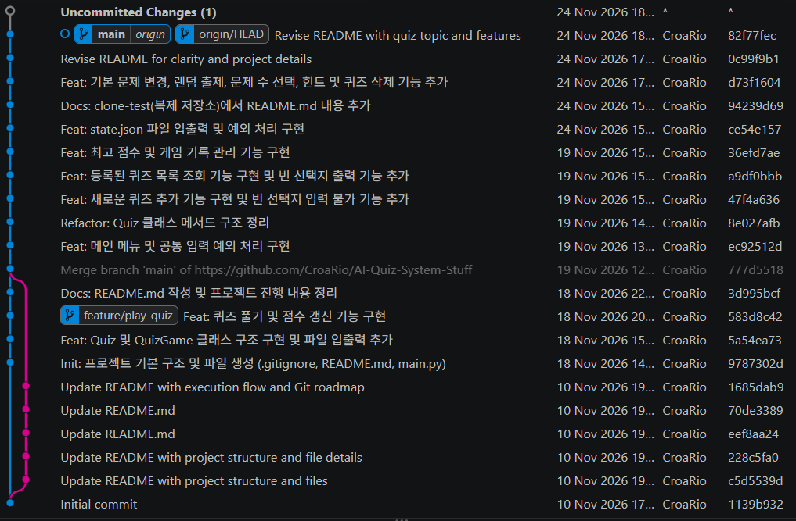
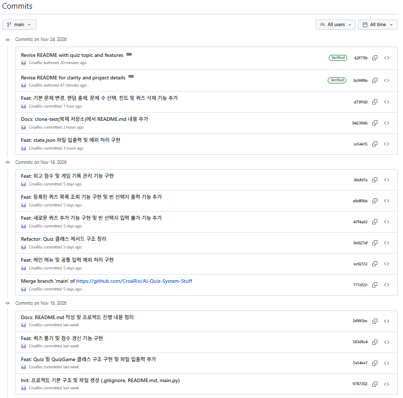
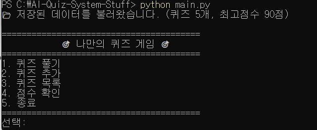
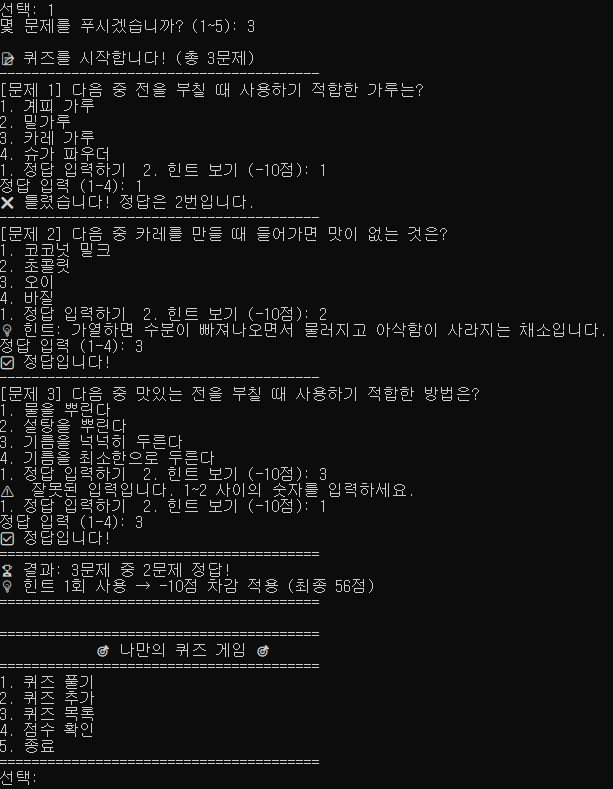
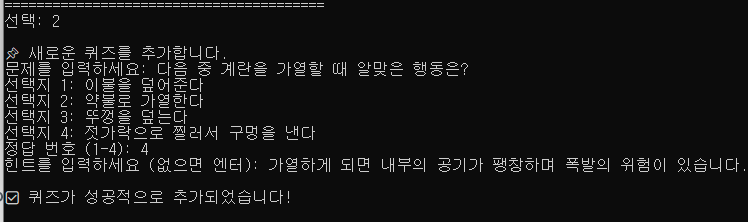
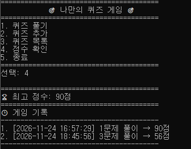
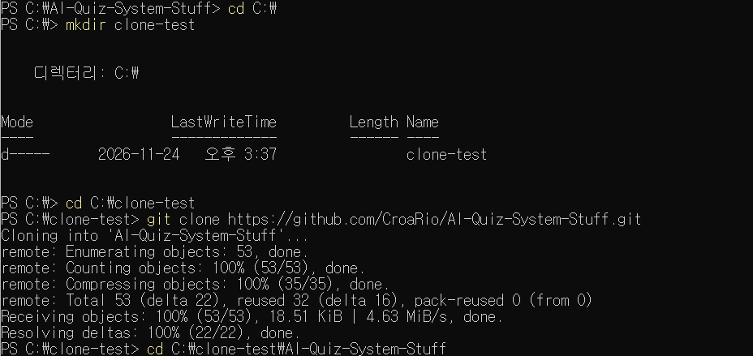
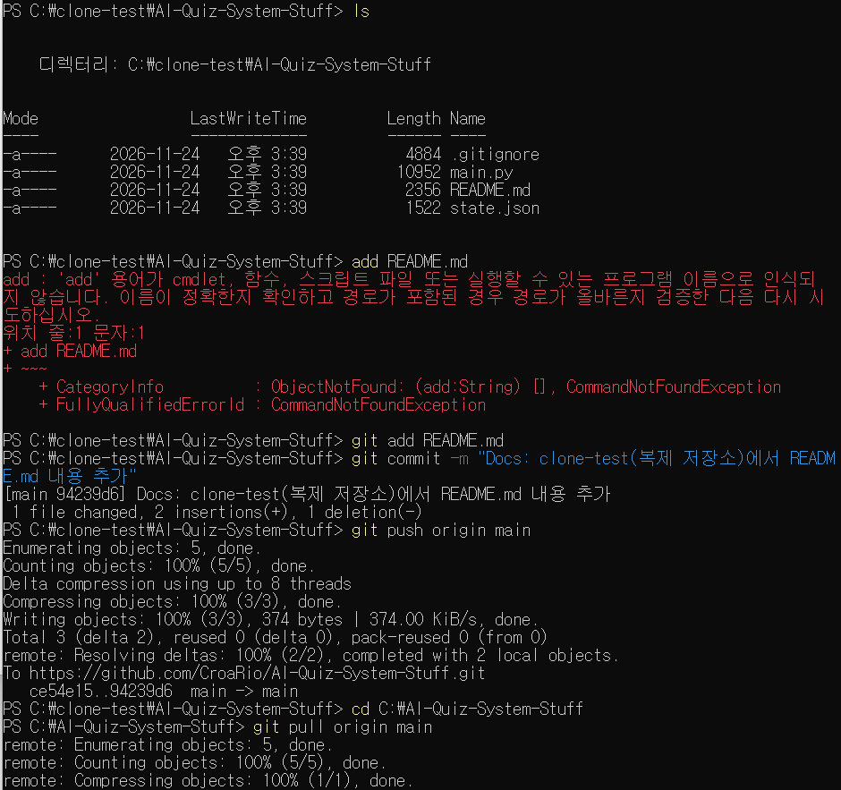

# 🎯 Python & Git 기반 나만의 퀴즈 게임

- **원격 저장소 URL:** `https://github.com/CroaRio/AI-Quiz-System-Stuff.git`

## 1. 프로젝트 개요
> Python 객체 지향 클래스(`Quiz`, `QuizGame`)와 `state.json` 기반 데이터 영속성, 입력 예외 처리를 적용한 터미널(CLI) 퀴즈 게임입니다. 보너스 과제인 랜덤 출제, 문제 수 선택, 힌트 및 점수 차감, 퀴즈 삭제, 게임 기록 히스토리까지 함께 구성했습니다.

## 2. 퀴즈 주제 선정 이유
> 일상 속 요리·식재료 선택과 조리 팁을 주제로 구성해, 누구나 부담 없이 직관적으로 풀 수 있는 퀴즈로 만들었습니다.
- **선정 주제:** 요리 및 식재료 활용·조리법 상식
- **선정 이유:** 카레 재료 궁합, 장보기 신선도 순서, 육수 재료 구분 등 실생활과 밀접한 주제로 퀴즈 흐름을 명확하게 확인하고 힌트·점수 기능을 자연스럽게 테스트할 수 있기 때문입니다. 그리고 요리는 재미있고 맛있으니까!

## 3. 실행 방법
프로그램을 실행하려면 터미널에 아래 명령어를 입력하세요.
```bash
python main.py
```

## 4. 기능 목록  
[x] 랜덤 출제 및 문제 수 선택: random 모듈로 출제 순서를 섞고, 원하는 문제 수만큼 선택해 퀴즈 풀기(100점 만점 기준 점수 계산)  
[x] 힌트 기능 및 점수 차감: 문제별 힌트 확인 기능과 힌트 사용 횟수(1회당 -10점, 최저 0점)에 따른 최종 점수 차감  
[x] 퀴즈 추가: 새 문제, 4가지 선택지, 정답 번호, 힌트를 입력받아 동적으로 추가 후 저장  
[x] 퀴즈 목록: 현재 등록된 모든 퀴즈와 선택지 확인  
[x] 퀴즈 삭제: 등록된 퀴즈 중 선택한 번호의 문제를 삭제하고 변경 사항을 파일에 즉시 반영  
[x] 점수 확인 및 게임 기록 히스토리: 역대 최고 점수와 함께 플레이 일시(YYYY-MM-DD HH:MM:SS), 푼 문제 수, 점수 기록 조회  
[x] 데이터 영속성 및 예외 처리: state.json 자동 생성·저장·복구와 잘못된 입력(ValueError, 빈 입력, 범위 초과, KeyboardInterrupt/EOFError) 방어

## 5. 파일 구조
```Plaintext
AI-Quiz-System-Stuff/
├── main.py          # 메인 실행 파일 및 클래스 정의 (Quiz, QuizGame)
├── state.json       # 퀴즈, 최고 점수, 게임 기록 저장 파일 (자동 생성)
└── README.md        # 프로젝트 설명 문서
```
## 6. 데이터 파일 설명
* (state.json)경로: 프로젝트 루트 (./state.json)
* 역할: 프로그램 종료 후에도 퀴즈 목록, 최고 점수, 게임 기록 히스토리를 보존하며, 파일이 없거나 손상된 경우 기본 퀴즈 데이터로 복구
* 필드 스키마 형태:
```JSON
{
    "best_score": 80,
    "history": [
        {
            "played_at": "2026-11-24 16:59:00",
            "questions_count": 5,
            "score": 80
        }
    ],
    "quizzes": [
        {
            "question": "다음 중 카레를 만들 때 들어가면 맛이 없는 것은?",
            "choices": ["코코넛 밀크", "초콜릿", "오이", "바질"],
            "answer": 3,
            "hint": "가열하면 수분이 빠져나오면서 물러지고 아삭함이 사라지는 채소입니다."
        }
    ]
}
```
  
데이터 저장 방식 한계 및 대안 비교현재 state.json은 구조가 직관적이고 사람이 읽기 쉽지만, 데이터가 커질수록 한계도 있습니다.  
  
| 구분 | 현재 방식 (state.json) | 대안 1:<br>NDJSON<br>(줄 단위 JSON) | 대안 2:<br>관계형/임베디드 DB<br>(SQLite 등) |
| :---: | :---: | :---: | :---: |
| **성능 및 메모리 비용** | 파일 전체를 한 번에 파싱하고 다시 씀.<br>퀴즈·기록이 많아지면 I/O와 메모리 부담 증가 | 줄 단위로 추가/읽기 가능해<br>로그·히스토리 append에 유리 | 조건 조회·부분 갱신에<br>최적화되어<br>대량 데이터에서도 안정적 |
| **장점** | 별도 설정 없이 가독성이 좋고<br>소규모 학습/CLI 프로젝트에 적합 | 추가 기록이 빠르고<br>일부 줄 손상 시 격리 처리가 쉬움 | 트랜잭션, 정합성,<br>대용량 검색/집계에 강함 |
| **단점** | 동시 쓰기나 대용량 누적 시 비효율적 | 전체 구조 검증이나<br>수정 시 파싱 로직이 필요 | 초기 스키마 설계 및<br>쿼리 작성 비용 발생 |
  
### 손상 복구 동작 및 백업/초기화 보완 방안
* **현재 구현:** load_data()에서 FileNotFoundError / os.path.exists 미존재 시 기본 퀴즈를 생성해 저장하고, JSONDecodeError 등 손상 시 "⚠️ 데이터 파일이 손상되었거나 읽을 수 없습니다. 기본 데이터로 복구합니다."를 출력한 뒤 기본 데이터로 복구합니다.
* **보완 방향:** 기존 state.json을 덮어쓰기 전에 .bak 백업 파일을 남기거나, 복구/초기화 시 사용자 확인(y/n)을 거치는 수동 초기화 옵션을 추가하면 실수로 기록이 날아가는 위험을 더 줄일 수 있습니다.  
  
## 7. 아키텍처 및 설계 선택 이유
**객체 지향 설계(Quiz, QuizGame) 채택 이유**
* **역할 분리:** 개별 문항의 데이터와 출력·정답 판별·직렬화(display, is_correct, to_dict)는 Quiz에, 파일 입출력·입력 검증·게임 진행·히스토리 관리는 QuizGame에 두어 책임을 나눴습니다.
* **함수 기반 구현과의 비교:** 작은 스크립트는 함수 중심으로도 빠르게 만들 수 있지만, 문항 속성(hint 등)과 게임 상태(quizzes, best_score, history)가 늘어나면 전역 변수나 딕셔너리 키 의존도가 높아집니다. 클래스를 쓰면 상태와 동작을 함께 묶어 유지보수와 기능 확장이 수월합니다.  
  
**요구사항 변경 시 수정 대상 매핑(영향도 분석)**

| 변경·확장 항목 | 주요 수정 파일 및 메서드 | 연동 확인 포인트 |
| :---: | :---: | :---: |
| **기본 퀴즈 주제/문항 변경** | main.py > QuizGame.init_default_quizzes | 기존 state.json이 있으면 삭제 또는 손상 복구로 재생성 확인|
| **출제 순서 및 문제 수 선택** | main.py > QuizGame.play_quiz | random.shuffle 후 선택 개수로 자른 리스트 기준 점수·기록 계산 | 
| **힌트 속성 및 점수 차감** | main.py > Quiz.__init__, Quiz.to_dict, QuizGame.load_data, QuizGame.add_quiz, QuizGame.play_quiz | 기존 JSON에 hint 키가 없어도 q.get("hint", "")로 호환 | 
| **퀴즈 삭제 기능** | main.py > QuizGame.delete_quiz, QuizGame.run | 삭제 후 save_data() 호출 및 메뉴 번호(1~6) 일치 확인 | 
| **게임 기록 히스토리** | main.py > QuizGame.__init__, QuizGame.load_data, QuizGame.save_data, QuizGame.play_quiz, QuizGame.show_score | played_at, questions_count, score 필드 저장 및 출력 확인 | 
| **JSON 입출력 예외 처리** | main.py > QuizGame.load_data, QuizGame.save_data, QuizGame.get_validated_input | 파일 미존재, JSON 문법 오류, 잘못된 콘솔 입력 시 중단 없이 처리 | 

## 8. Git 워크플로우, 커밋 규칙 및 실습 증빙
### 커밋 규칙

* **형식:** <타입>: <변경 내용 요약> (예: Feat: 최고 점수 및 게임 기록 관리 기능 구현, Docs: README.md 보완)
* **주요 타입:** Feat(기능 추가/개선), Fix(오류 수정), Docs(문서 작성/수정), Chore(설정 및 기타 작업)
* **커밋 단위:** 기능·단계별로 의미 있는 단위를 나누어 커밋해 변경 이력을 추적하기 쉽게 유지합니다.
  
### 브랜치 전략 및 병합 의미
* 작업 단위별로 브랜치(예: feat/..., fix/...)를 나누어 개발하면 불안정한 수정이 main 브랜치에 바로 섞이는 것을 막을 수 있고, 검증이 끝난 뒤 merge로 합쳐 안정적인 배포 기준선(main)을 유지할 수 있습니다.
* **브랜치 목록 증빙(pics/브랜치-목록-증빙.png):**
  
* **커밋 로그(10개 이상) 및 병합 로그 증빙(pics/커밋-로그-및-병합-로그-증빙.png):**
  

## 9. 스크린샷 (실행 화면 및 복제/동기화 실습)
* 메뉴 화면 (pics/메뉴-화면.png):
  
* 퀴즈 풀기 (pics/퀴즈-풀기.png):
  
* 퀴즈 추가 (pics/퀴즈-추가.png):
  
* 점수 확인 (pics/점수-확인.png):
  
* git clone → 수정/푸시 → 원래 폴더 git pull 실습 화면 (pics/git-clone-수정-푸시-및-git-pull-실습-1.png, pics/git-clone-수정-푸시-및-git-pull-실습-2.png):
  
  
